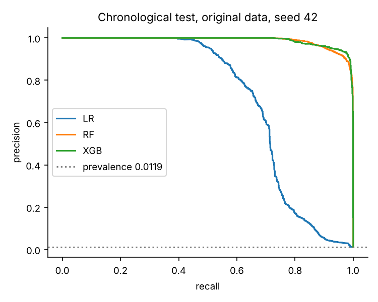
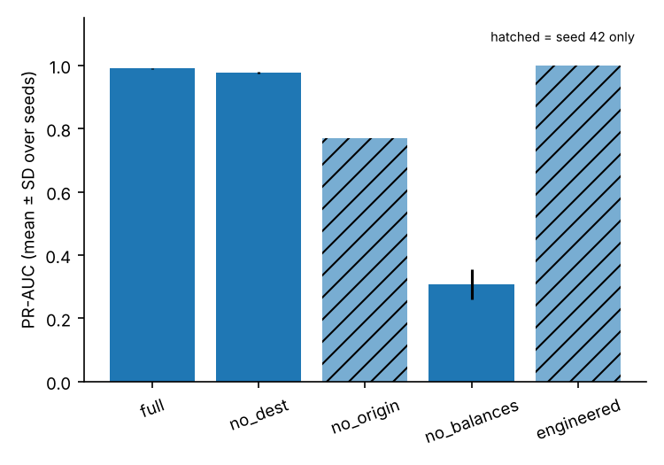
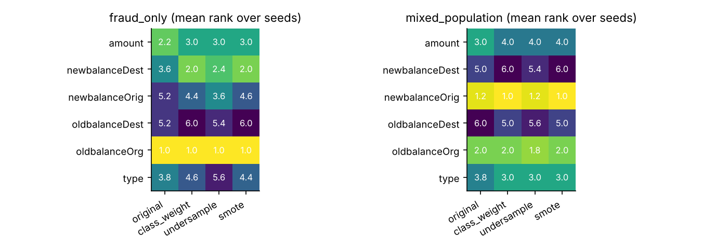

# Fraud Detection in Mobile Money Transactions (PaySim)

Code and results for my undergraduate thesis in Smart Computing at Kyungdong University Global Campus:

> **Machine Learning-Based Detection of Fraudulent Mobile Money Transactions: A Comparative, Temporally-Validated, and Explainable Approach Using the PaySim Dataset**
> Supervisor: Dr. Ahmed Absi

> **Status: thesis under review.** The defense is in the first week of December 2026. Text and results in this repository may still change before then.

<!-- TODO before defense: update the status line above after the defense (e.g. "Defended December 2026") and add a link to the final thesis PDF if you publish it. -->

The study compares Logistic Regression, Random Forest and XGBoost under four ways of handling class imbalance. It tests them on a chronological split, so models always predict the future. It then asks a harder question: **what is the model actually relying on?** Feature ablation and SHAP stability analysis answer that.

## Key findings

<!-- TODO before defense: re-check these five points against the final Chapter 4 and 6 wording, so the README and thesis say the same thing. -->

- **Tree models win by a wide margin.** Random Forest and XGBoost reach PR-AUC 0.968 to 0.992. Logistic Regression reaches 0.708 to 0.830. No single best tree model is named, because their differences fall inside the bootstrap intervals.
- **Imbalance handling barely matters for trees.** Original data, class weighting and SMOTE are within about 0.004 PR-AUC of each other. Undersampling is the weakest condition for both tree models in every seed. SMOTE helps Logistic Regression a lot (0.830 vs 0.708).
- **The high scores depend on account balances.** Removing all four balance fields drops XGBoost from PR-AUC 0.990 to 0.307, and the result becomes unstable across seeds. This shows model dependence on the simulator's balance structure. It does not prove label leakage.
- **SHAP explanations are fairly stable.** Feature rankings agree well between resampled models (Spearman 0.97) and less well between original and resampled models on fraud cases (0.73).
- **Unsupervised detection is weak here.** Isolation Forest reaches PR-AUC 0.081 and misses about 70% of fraud.

## Data

PaySim (Lopez-Rojas et al., 2016) simulates mobile money transactions from an African provider's logs. The file has 6,362,620 transactions over 743 hourly steps.

- **Simulator:** [EdgarLopezPhD/PaySim](https://github.com/EdgarLopezPhD/PaySim) by Dr. Edgar Lopez-Rojas (GPL-3.0). This repository does not include any simulator code.
- **Dataset used here:** the PaySim sample published on Kaggle, [ealaxi/paysim1](https://www.kaggle.com/datasets/ealaxi/paysim1), which the simulator's repository links to.
- The PaySim authors ask users to cite Lopez-Rojas, Elmir & Axelsson (2016), listed under [References](#references).

A data audit found that the last 25 steps (719 to 743) contain **only fraud** (296 rows, no legitimate transactions). This looks like a data-generation artifact, so the primary analysis uses steps 1 to 718 (6,362,324 rows, 0.124% fraud).

Download instructions: [`data/README.md`](data/README.md)

## Method

The full protocol was frozen before the main runs: [`PROTOCOL.md`](PROTOCOL.md).

| Item | Choice |
|---|---|
| Features | `type`, `amount`, 4 balance fields. IDs, `step` and `isFlaggedFraud` excluded |
| Chronological split | train steps 1 to 502, validation 503 to 610, test 611 to 718 |
| Random split | stratified 70/15/15, used as a comparison design |
| Models | Logistic Regression, Random Forest, XGBoost. Isolation Forest as an unsupervised baseline |
| Imbalance | original, class weighting, random undersampling (1:1), SMOTE (0.1). Training data only |
| Threshold | maximum F1 on validation, applied once to test |
| Uncertainty | 5 training seeds, class-conditional bootstrap 95% CIs (1,000 resamples) |
| Explainability | XGBoost TreeSHAP rank stability across seeds and imbalance conditions |
| Ablation | XGBoost retrained without destination, origin, or all balance fields |

Fraud prevalence rises sharply over time: 0.09% in training, 0.56% in validation, 1.19% in test. PR-AUC and precision depend on prevalence, so chronological and random results are reported separately and never ranked against each other.

## Results

### Model comparison (chronological test, prevalence 1.19%)

Mean over 5 seeds. Logistic Regression original and class weighting are deterministic single fits.

| Model | Imbalance | PR-AUC | Precision | Recall | F1 |
|---|---|---|---|---|---|
| Logistic Regression | original | 0.708 | 0.855 | 0.581 | 0.692 |
| | class weight | 0.740 | 0.871 | 0.555 | 0.678 |
| | undersample | 0.735 | 0.854 | 0.569 | 0.683 |
| | SMOTE | **0.830** | 0.894 | 0.640 | 0.746 |
| Random Forest | original | 0.988 | 0.948 | 0.911 | 0.929 |
| | class weight | 0.991 | 0.960 | 0.921 | 0.940 |
| | undersample | 0.971 | 0.938 | 0.848 | 0.890 |
| | SMOTE | **0.992** | 0.955 | 0.938 | 0.946 |
| XGBoost | original | 0.990 | 0.945 | 0.957 | 0.951 |
| | class weight | 0.990 | 0.937 | 0.968 | 0.952 |
| | undersample | 0.968 | 0.939 | 0.823 | 0.877 |
| | SMOTE | **0.991** | 0.951 | 0.955 | 0.953 |

Seed standard deviations for PR-AUC are 0.0001 to 0.005. Full table with ROC-AUC, FPR and alert counts: [`results/final_main_table.csv`](results/final_main_table.csv).

<p align="center"></p>

### Feature ablation (XGBoost, original data, chronological test)

| Features | Seeds | PR-AUC | Recall | Change |
|---|---|---|---|---|
| Full (type, amount, 4 balances) | 5 | 0.990 ± 0.001 | 0.957 | |
| No destination balances | 5 | 0.977 ± 0.002 | 0.927 | -0.013 |
| No origin balances | 1 | 0.771 | 0.688 | -0.219 |
| No balances | 5 | 0.307 ± 0.047 | 0.171 | -0.683 |
| Engineered balance errors | 1 | 0.999 | 0.997 | +0.009 |

The no-balance result is unstable: across seeds and cutoffs it ranged from about 0.08 to 0.34. It still beats the no-skill baseline (0.012), so type and amount carry some signal, but far less than the balances.

<p align="center"></p>

### SHAP rank stability (5 seeds, 15 pairs per row)

| Sample | Comparison | Spearman (mean ± SD) |
|---|---|---|
| Mixed population (20,000 rows) | resampled vs resampled | 0.97 ± 0.03 |
| Mixed population | original vs resampled | 0.87 ± 0.06 |
| Fraud only (1,192 rows) | resampled vs resampled | 0.91 ± 0.07 |
| Fraud only | original vs resampled | 0.73 ± 0.23 |

`oldbalanceOrg` ranked first among fraud cases in every condition and seed.

<p align="center"></p>

### Isolation Forest (unsupervised baseline)

PR-AUC 0.081 ± 0.006, ROC-AUC 0.831 ± 0.009, recall 0.297, about 3,070 alerts on 100,057 test transactions.

## Prototype

[`prototype/fraud_scorer.py`](prototype/fraud_scorer.py) is a scoring workflow built on the seed-42 XGBoost model. It:

- validates input and rejects IDs, labels, unknown types, and negative or non-finite values
- returns a fraud score, the threshold, and a review/approve decision
- gives per-feature SHAP contributions on request
- scores the same transaction with a no-balance comparator model
- verifies a SHA-256 hash of every model file before loading

It passes 21 automated checks ([`results/prototype/test_results.json`](results/prototype/test_results.json)). These are software checks, not evidence of real-world performance. Try it without downloading the dataset:

```bash
python prototype/demo.py
```

A TRANSFER that drains the sender's account scores 0.989 with the full model and is sent to review. The no-balance comparator scores it 0.051 and approves it. That one example shows the balance dependence the ablation measured.

## Repository structure

```
├── code/
│   ├── 01_audit.py                  data audit, tail detection
│   ├── 02_define_tail_and_splits.py chronological and random splits
│   ├── 03_baseline_logistic_regression.py
│   ├── 04_model_comparison.py       3 models x 4 imbalance conditions x 2 designs x 5 seeds
│   ├── 05_ablation_xgboost.py       feature ablation
│   ├── 06_shap_stability.py         SHAP rank stability
│   ├── 07_lr_discrepancy.py         float32 vs float64 LR diagnosis
│   ├── 08_reproducibility_record.py versions, seeds, parameters
│   ├── 09_shap_aggregate.py
│   ├── 10_aggregate_results.py      refuses to run if any expected run is missing
│   ├── 11_make_figures.py
│   ├── 12_isolation_forest.py
│   ├── 13_cutoff_sensitivity.py     alternative tail cutoffs
│   ├── 14_build_prototype.py
│   ├── 15_test_prototype.py         21 checks
│   └── common.py                    threshold rule, metrics, bootstrap
├── prototype/                       scorer + demo
├── results/                         all result tables, audit, prototype artifacts
├── figures/                         thesis figures
├── PROTOCOL.md                      frozen experiment protocol
└── run_all.sh                       reproduces everything from the raw CSV
```

## Reproduce

```bash
git clone https://github.com/<your-username>/paysim-fraud-detection.git
cd paysim-fraud-detection
python -m venv .venv && source .venv/bin/activate
pip install -r requirements.txt
# download PaySim into data/ (see data/README.md), then:
./run_all.sh
```

The full run takes several hours on 2 CPU cores and needs about 7 GB of memory. Per-model score files (~380 MB) and split indices (~100 MB) are regenerated by the scripts, so they are not committed.

## Limitations

- **Synthetic data.** PaySim imitates real behaviour but is not real. Its fraud-label generation is not fully documented. None of these results are claimed to transfer to live mobile money systems.
- **Short time span.** About one month of simulated time is too short to study concept drift. The chronological split tests a stricter evaluation, not drift adaptation.
- **Prevalence shift.** Fraud prevalence rises across the chronological partitions, which limits comparison with the random design.
- **Balance fields.** The models depend heavily on balance fields whose availability at prediction time in a real system is uncertain.
- **SHAP is associational.** It explains what a model learned, not what causes fraud.

## References

- Lopez-Rojas, E. A., Elmir, A., & Axelsson, S. (2016). PaySim: A financial mobile money simulator for fraud detection. *28th European Modeling and Simulation Symposium.*
- Lundberg, S. M., & Lee, S.-I. (2017). A unified approach to interpreting model predictions. *NeurIPS.*
- Liu, F. T., Ting, K. M., & Zhou, Z.-H. (2008). Isolation forest. *IEEE ICDM.*

## Author

**Cheruiyot Leon Kipkorir**, B.S. Smart Computing, Kyungdong University Global Campus
[LinkedIn](https://www.linkedin.com/in/leon-k-ab7333438)

## Acknowledgements

- **Dr. Ahmed Absi**, thesis supervisor, Kyungdong University Global Campus.
- **Claude (Anthropic)**, AI assistant and contributor. Claude helped write and run the analysis code, monitored the long multi-seed runs, and helped draft this documentation. I directed the study design and reviewed the results. Commits that Claude worked on are marked with a `Co-Authored-By` line.
- **Dr. Edgar Lopez-Rojas** and co-authors, for the [PaySim simulator](https://github.com/EdgarLopezPhD/PaySim) and dataset.

<!-- TODO before defense: check that the Claude acknowledgement matches the AI-use statement in your thesis and KDU's AI policy, and adjust the wording if needed. -->


MIT License
